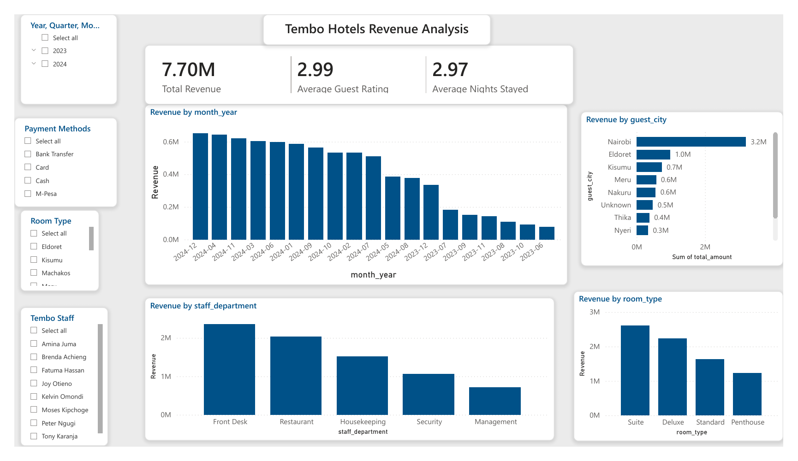
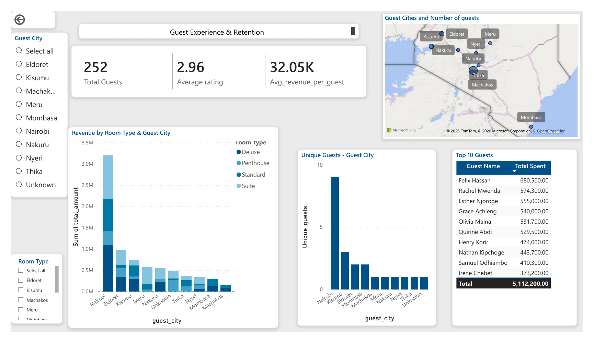
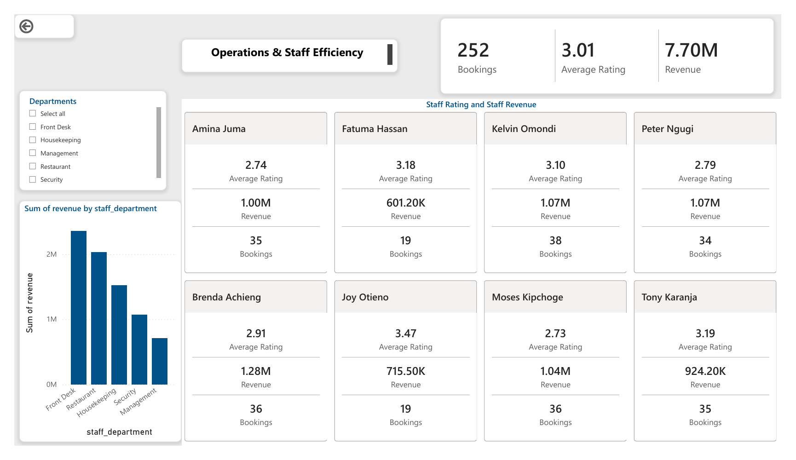

# Tembo Hotels | Power BI Capstone Project

An interactive **hotel business intelligence dashboard** developed in Microsoft Power BI to explore **revenue performance, guest experience, and staff operations**.

The report is designed to help hotel management identify high-performing customer markets, understand guest spending patterns, and evaluate operational metrics in one place.

> **Project scope:** Three report pages covering Revenue Analysis, Guest Experience & Retention, and Operations & Staff Efficiency. The report's date slicer includes 2023 and 2024.

## Dashboard at a Glance

| Metric | Value shown | Dashboard page |
| --- | ---: | --- |
| Total revenue | 7.70M | Revenue Analysis |
| Average guest rating | 2.99 | Revenue Analysis |
| Average nights stayed | 2.97 | Revenue Analysis |
| Total guests | 252 | Guest Experience & Retention |
| Average revenue per guest | 32.05K | Guest Experience & Retention |
| Total bookings | 252 | Operations & Staff Efficiency |

**Note:** Figures above are transcribed from dashboard KPI cards. Revenue currency is not specified in the exported report; average ratings differ by page and should be reconciled before making cross-page comparisons.

## Business Questions

1. Which guest cities and room categories contribute the most revenue?
2. How does guest spending vary by location and room type?
3. Which guests contribute the most spending?
4. What do guest ratings reveal about the customer experience?
5. How do staff and departments compare on bookings, ratings, and attributed revenue?

## Dashboard Pages

### 1. Revenue Analysis



The overview page presents total revenue, average guest rating, and average length of stay, with charts for monthly revenue, revenue by guest city, department, and room category.

**Highlights:**
- Nairobi accounts for approximately **3.2M** in guest-city revenue, with Eldoret next at approximately **1.0M**.
- **Suite** and **Deluxe** rooms lead room-category revenue.
- The report supports filtering by date, payment method, and other displayed dimensions.

**Potential action:** Review targeted promotions for high-revenue guest markets and pricing strategies across room categories.

### 2. Guest Experience & Retention



This page explores guest distribution and spending with a location map, room-type-by-city chart, guest counts by city, and a top-10 guest spending table.

**Highlights:**
- The dashboard displays **252 guests**, an **average rating of 2.96**, and **32.05K average revenue per guest**.
- The **top 10 guests** have combined recorded spending of approximately **5.11M**.
- Nairobi leads the guest-city charts.

**Potential action:** Investigate guest feedback and consider personalized offers or loyalty initiatives for high-spending guests.

**Scope note:** Although this page is titled “Guest Experience & Retention,” it does **not** display a repeat-guest or retention-rate measure. Retention should not be inferred from spending alone.

### 3. Operations & Staff Efficiency



This page combines booking, rating, and revenue metrics with department-level revenue and staff performance cards.

**Highlights:**
- The report displays **252 bookings**, **7.70M revenue**, and an **average rating of 3.01**.
- **Front Desk** has the highest attributed department revenue, followed by **Restaurant**.
- **Brenda Achieng** has the highest displayed individual revenue at approximately **1.28M**.
- **Joy Otieno** has the highest displayed individual average rating at **3.47**.

**Potential action:** Combine revenue, bookings, and guest ratings to guide recognition and coaching, with appropriate consideration of staff roles and assignments.

## Tools and Features

- **Microsoft Power BI Desktop** — interactive dashboards and report authoring.
- **Power BI slicers** — date, location, payment method, staff, and department filtering as shown in the report.
- **Visualizations** — KPI cards, bar and column charts, geographic map, and guest spending table.
- **Three analytical views** — commercial performance, guest insights, and staff operations.

The source dataset, transformation steps, and measure definitions have not been separately documented in this repository. Open the `.pbix` file to inspect the underlying model and report configuration.

## Repository Contents

```text
Tembo-Hotels-PowerBI/
├── README.md
├── PRESENTATION.md
├── Tembo_Hotels_Revenue_Analysis.pbix
├── Tembo_Hotels_Dashboard.pdf
└── assets/
    └── screenshots/
        ├── revenue-analysis.png
        ├── guest-experience.png
        └── operations-staff.png
```

## How to Explore the Project

1. **Preview online:** Review the three dashboard images above.
2. **Read the presentation guide:** Open [`PRESENTATION.md`](PRESENTATION.md) for a 3–4 minute walkthrough and talking points.
3. **View the full static report:** Open [`Tembo_Hotels_Dashboard.pdf`](Tembo_Hotels_Dashboard.pdf).
4. **Explore interactively:** Download [`Tembo_Hotels_Revenue_Analysis.pbix`](Tembo_Hotels_Revenue_Analysis.pbix) and open it in **Power BI Desktop**. Use the available slicers to examine filtered results.

> Depending on your Power BI Desktop environment, some custom visuals or map features may require additional support or configuration. The PDF and screenshots provide a static alternative.

## Business Recommendations

| Area | Recommended next step |
| --- | --- |
| Revenue | Prioritize analysis of Nairobi demand and test room-category pricing or promotions. |
| Guest experience | Investigate average ratings and analyze feedback to identify service improvements. |
| Customer value | Explore loyalty and personalized offers for high-spending guests. |
| Operations | Review booking volume, guest ratings, and attributed revenue together when coaching staff. |

## Data and Dashboard Validation Notes

The exported report raises a few items worth confirming before using its numbers for formal business decisions:

- **Ratings:** Average rating is shown as **2.99**, **2.96**, and **3.01** on different pages; measure definitions and filter contexts need checking.
- **Average spend:** The **32.05K** per-guest KPI does not directly match total revenue divided by the displayed 252 guests; verify the calculation and population.
- **Time series:** The monthly revenue chart appears sorted by revenue magnitude rather than calendar order, so it should not be read as a chronological trend.
- **Slicer labels:** Some controls titled “Room Type” show city values and should be reviewed.
- **Currency:** No explicit currency symbol or code appears on the dashboard.
- **Retention:** A repeat-booking or retention-rate KPI is not included in the exported views.

## Publishing Considerations

The exported dashboard visibly includes **guest names, staff names, and spending amounts**. Before publishing a **public** GitHub repository, confirm that the data is synthetic or that you have permission to disclose it. The `.pbix` file may also contain embedded underlying data; if these are real customer records, anonymize them or keep the repository private.

## Possible Next Improvements

- Standardize and document all KPI measures, definitions, and filter behavior.
- Correct slicer titles and order the monthly axis chronologically.
- Add year-over-year comparisons, occupancy rates, and repeat-guest metrics **when the required source data is available**.
- Add clear currency labels and a data dictionary.

---

**Project files:** [Power BI report](Tembo_Hotels_Revenue_Analysis.pbix) · [PDF export](Tembo_Hotels_Dashboard.pdf) · [Presentation guide](PRESENTATION.md)
